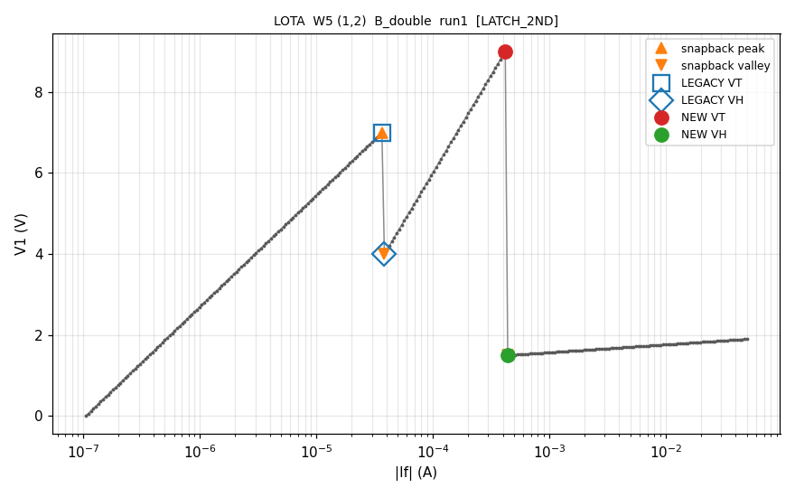

# latchup-rejudge

force-I sweep로 측정한 latch-up V-I 곡선을 끝까지 본 뒤에 다시 판정해서 **VT(trigger) / VH(hold)**를 구합니다.

기존 판정은 ΔV 부호가 처음 바뀌는 점을 VT, 그다음 부호 변화를 VH로 잡습니다. 그래서 1차 snapback 후 래치가 유지되지 못하고 V가 다시 올라가다 2차 snapback에서 래치되는 소자(이중 snapback)는 1차 값이 기록됩니다. 칩마다 1차 또는 2차가 잡히면서 Trend가 두 그룹으로 갈라집니다. 이 스크립트는 **끝까지 유지된 snapback만 래치로 인정**합니다.



## 입력

```
EQPID,PCID,PARTID,LOTID,WFID,XAXIS,YAXIS,DCOP,MOD,ITEM,NUM,If,V1
EQPA,CARDA,PARTA,LOTA,5,7,2,DCOPA,MODA,ITEMA,1,1.05e-07,0.004952
```

- 곡선 하나 = `EQPID`~`ITEM` 키 + `NUM`(sweep step). `If`는 인가 전류, `V1`은 측정 전압입니다.
- 같은 키에서 `NUM`이 다시 작아지면 재측정으로 보고 별도 곡선(`RUN` 2, 3 …)으로 나눕니다.
- 중간에 반복된 header 행이나 해석할 수 없는 행은 건너뜁니다.
- 음방향 전류 주입(−I)은 극성을 뒤집어서 판정하고, 결과는 원래 부호로 냅니다.

## 실행

Python 3.6 이상, 표준 라이브러리만 씁니다. `--plot`을 쓸 때만 matplotlib이 필요합니다.

```bash
python3 latchup_rejudge.py data.log                        # → latchup_rejudge_result.csv
python3 latchup_rejudge.py *.log -o result.csv --plot plots
python3 latchup_rejudge.py examples/sample_lup.log --plot plots   # 합성 예제
```

## 판정 방법

1. **Snapback 검출 (hysteresis)**: peak 이후 V가 `thr = max(DV_ABS, DV_REL × |Vpeak|)` 이상 떨어지면 snapback 하나입니다. valley 이후 V가 `DV_ABS` 넘게 다시 오르면 valley가 확정됩니다. 이보다 작은 흔들림은 노이즈로 봅니다.
2. **래치 확정**: snapback k마다 다음 비율을 구합니다.
   - `depth = Vpeak − Vvalley`
   - `rerise = max(V[valley:끝]) − Vvalley`
   - `rerise ≤ RECOVER × depth`이면 래치가 유지된 것으로 봅니다. 래치 후 Ron 때문에 V가 완만히 오르는 정도는 허용됩니다.
3. 이 조건을 처음 만족하는 snapback의 peak가 **VT**이고, 그 이후 가장 낮은 V가 **VH**입니다.

| STATUS | 의미 |
|---|---|
| `LATCH` | 1차 snapback이 그대로 래치 |
| `LATCH_2ND` | 앞쪽 snapback은 회복(가짜 trigger)되고 뒤에서 래치. `VT1/VH1` = 1차 값 |
| `NO_LATCH` | snapback은 있었지만 모두 회복 |
| `NO_TRIGGER` | snapback 없음 |
| `*_SHORT` | 래치 뒤 남은 측정점이 `--min-hold-pts` 미만이라 유지 확인이 부족함 |

### VT 선택 규칙 (`--rule`, 기본 `main`)

| 규칙 | VT로 쓰는 snapback | STATUS |
|---|---|---|
| `main` (기본) | depth가 최대 depth × `--main-frac`(0.7) 이상인 snapback 중 peak V가 가장 높은 것. 작은 pre-trigger와 래치 후 Ron 구간의 작은 흔들림을 함께 거릅니다 | `TRIGGER` (snapback 1개) / `TRIGGER_MULTI` (여러 개) / `NO_TRIGGER` |
| `maxpeak`, `deepest`, `first`, `last` | peak V 최고 / 가장 깊음 / 첫 번째 / 마지막 | 위와 같음 |
| `sustain` | 위 "판정 방법"의 래치 유지 확인. 래치 후 V가 Ron 때문에 크게 오르는 소자에는 맞지 않습니다 | `LATCH` / `LATCH_2ND` / `NO_LATCH` / `NO_TRIGGER` |

VH는 고른 snapback의 valley입니다. `VT_ORDER` 컬럼에 몇 번째 snapback이 선택됐는지 나옵니다.

### 옵션

| 옵션 | 기본값 | 설명 |
|---|---|---|
| `--find-start` | 6 | 판정 시작 index (0-based). 저전류 구간의 노이즈를 건너뜁니다 |
| `--dv-abs` | 0.05 | snapback 최소 drop, valley 재상승 인정폭 (V) |
| `--dv-rel` | 0.03 | snapback 최소 drop 비율 (\|Vpeak\| 대비) |
| `--recover` | 0.5 | 재상승폭 ÷ depth가 이 값을 넘으면 회복으로 판정 |
| `--min-hold-pts` | 3 | 래치 후 최소 유지 확인 점 수 |
| `--legacy-pad` | 0 | legacy 재현 시 배열을 이 길이까지 0으로 채움 (기존 장비처럼 break 뒤 0이 남는 동작 재현) |
| `--plot DIR` | - | 곡선 PNG 저장. 기본은 `LATCH`가 아니거나 legacy와 값이 다른 곡선만 그립니다 |
| `--plot-all`, `--plot-max` | -, 300 | 전체 plot, 최대 개수 |

기준값 조정:
- 래치 후 V가 많이 오르는 소자에서 `NO_LATCH`가 많이 나오면 `--recover`를 올립니다.
- 노이즈가 snapback으로 잡히면 `--dv-abs`나 `--dv-rel`을 올립니다.
- 결과 CSV의 `RERISE_RATIO` 분포를 보고 정하면 됩니다.

실행이 끝나면 `[진단]` 요약(측정점 수, snapback 수 분포, `NO_LATCH`의 `RERISE_RATIO` 분포)이 함께 나옵니다. 기준값을 정할 때 씁니다.

## 칩별 변경 내역

legacy와 값이 달라진 칩을 ITEM별로 콘솔에 보여주고(`--show`, 기본 ITEM당 10개), 전체는 `<out>_changes.csv`로 저장합니다.

```
  ITEM B_double : 변경 1 / 1
    - 1번째 → 2번째 snapback                     1
    WF  X  Y  snap | VT  legacy → new          | VH  legacy → new          | 유형
    5   1  2  2    | 7.000(#121) → 9.000(#171) | 4.000(#122) → 1.500(#172) | 1번째 → 2번째 snapback
```

`(#NUM)`은 sweep step 번호입니다. 변경 유형:

| 유형 | 의미 |
|---|---|
| `k번째 → m번째 snapback` | legacy는 k번째, 새 판정은 m번째 snapback을 VT로 씀 |
| `legacy 노이즈 지점 → m번째 snapback` | legacy VT가 snapback이 아닌 미세 흔들림 지점이었음 |
| `legacy만 VT (snapback 아님)` | snapback이 없는데 legacy가 VT를 냄 |
| `새로 VT 검출` | legacy는 VT가 없는데 새 판정은 있음 |
| `VT 같음 (VH만 변경)` | VT는 같고 VH만 다름 |

## ITEM별 legacy → 새 판정 비교

실행하면 콘솔에 ITEM별 표가 나오고 `<out>_item_compare.csv`(VT, VH)로도 저장됩니다. 실제 ITEM 이름을 씁니다.

| 열 | 내용 |
|---|---|
| LEGACY / NEW | 중앙값 / rσ / p10~p90 / out |
| VT변경 | legacy와 값이 다른 곡선 수 |
| Δmed | 새 중앙값 − legacy 중앙값 |
| 판정 | 개선(rσ·폭 20% 넘게 감소 또는 out 30% 넘게 감소) / 악화 / 혼재 / 동일 / 중앙값 이동 |

## 분석 리포트 (`<out>_report.txt`)

칩 ID나 원시값 없이 집계 통계만 담습니다. 데이터를 밖으로 못 내는 환경에서 판정 규칙을 정할 때 씁니다.

| 절 | 내용 |
|---|---|
| [1] | sweep 종료 방식 (끝까지 측정 vs 중간 종료, 마지막 V/I) |
| [2] | k번째 snapback의 peak V, peak 전류, depth 분포 |
| [3] | snapback 전류가 decade 경계(SMU range 전환)에 몰리는지 검사 |
| [4] | LEGACY VT를 snapback 개수(0 / 1 / 2개 이상)로 나눈 분포 |
| [5] | 규칙 후보(LEGACY / FIRST / DEEPEST / LAST / MAXPEAK)별 VT·VH 분포, robust σ, bimodality coefficient |
| [6] | ITEM별 규칙 비교 (ITEM 이름 대신 순번) |
| [7] | 곡선이 가장 많은 ITEM 2개의 규칙별 VT 텍스트 히스토그램 |
| [8] | MAIN VT outlier가 몇 번째 snapback을 골랐는지, 그 전류와 depth를 정상 곡선과 비교 |
| [9] | snapback이 없는 곡선이 섞인 ITEM의 웨이퍼별, die 위치(중심/중간/가장자리)별 비율 |

## 출력 CSV

| 컬럼 | 내용 |
|---|---|
| `EQPID`~`ITEM`, `RUN`, `N_POINTS`, `SRC` | 곡선 키, 재측정 순번, 점 수, 원본 파일 |
| `LEGACY_VT/VH` (`_I`, `_NUM`) | 기존 판정 재현값 (ΔV 부호 변화) |
| `STATUS`, `N_SNAP` | 새 판정 상태, 검출된 snapback 수 |
| `VT/VH` (`_I`, `_NUM`) | 새 판정 trigger / hold 전압, 그때의 전류, NUM |
| `VT1/VH1` (`_I`) | 1차 snapback의 peak / valley |
| `HOLD_PTS`, `RERISE_RATIO` | 래치 후 측정점 수, 재상승폭 ÷ depth |
| `SNAP_DEPTH`, `TAIL_VMAX`, `TAIL_VMAX_NUM` | 진단: 판정에 쓴 snapback의 depth, valley 이후 최고 전압과 그 NUM |
| `LAST_VT`, `LAST_VH`, `V_LAST` | 진단: 마지막 snapback의 peak / valley, 마지막 측정 전압 |
| `VT_CHANGED`, `VH_CHANGED` | legacy와 다르면 `Y` |
| `VT_SHIFT`, `VH_SHIFT` | 새 값 − legacy 값 (V) |
| `VT_NUM_SHIFT`, `VH_NUM_SHIFT` | 새 NUM − legacy NUM (몇 step 뒤로 옮겨졌는지) |

## 그래프 (`--plot`)

- 곡선별 PNG:
  - legacy VT/VH는 파란 네모/마름모, 새 VT/VH는 빨간/초록 원으로 표시합니다.
  - legacy에서 새 값으로 옮겨진 경우 화살표로 잇고, 왼쪽 위에 두 판정의 V, I, NUM을 적습니다.
  - `NO_LATCH`는 valley 이후 최고점(회복으로 판정한 근거)을 보라색 X로 표시합니다.
- `_summary_legacy_vs_new.png`: 전체 곡선의 VT/VH 분포를 legacy와 새 판정으로 겹쳐 그리고, legacy VT 대비 새 VT 산점도를 함께 그립니다. Trend가 두 그룹으로 갈렸던 것이 한 그룹으로 모이는지 확인할 때 씁니다.

## 예제

`examples/sample_lup.log`는 `examples/gen_sample.py`로 만든 합성 데이터입니다 (269 step, 100 nA × 1.05ⁿ).

| 곡선 | legacy VT / VH | 새 VT / VH | STATUS |
|---|---|---|---|
| 단일 snapback | 8 / 1.5 | 8 / 1.5 | LATCH |
| 이중 snapback (7→4, 9→1.5) | 7 / 4 | 9 / 1.5 | LATCH_2ND |
| 이중, Vt2 < Vt1 (7→4, 6→1.5) | 7 / 4 | 6 / 1.5 | LATCH_2ND |
| 이중 + 노이즈 ±5 mV | 7.0 / 4.0 | 9.01 / 1.50 | LATCH_2ND |
| 음극성 이중 | −7 / −4 | −9 / −1.5 | LATCH_2ND |
| snapback 후 회복 | 8 / 4 | - | NO_LATCH |
| 트리거 없음 | - | - | NO_TRIGGER |
